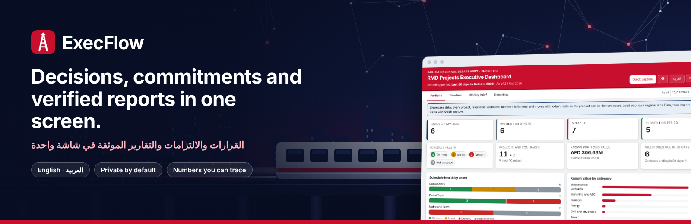
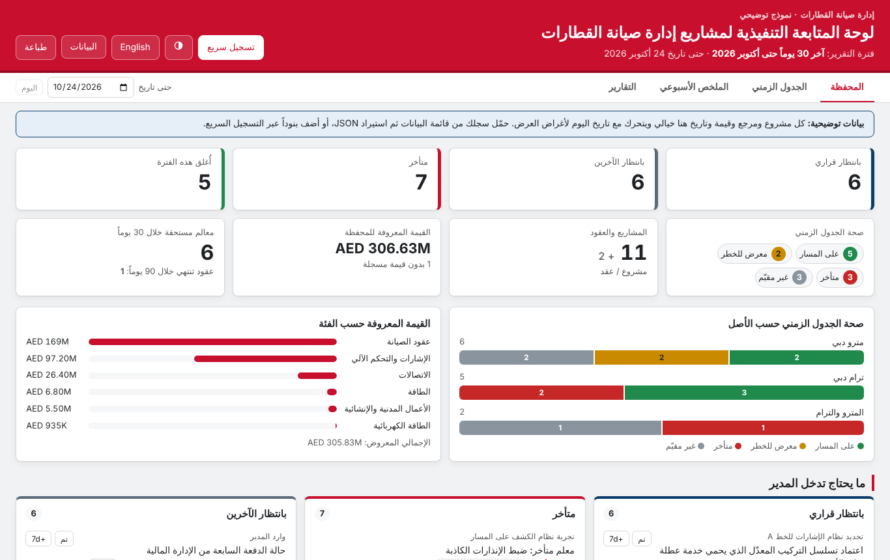

<div dir="rtl">

<p align="center">
  
</p>

# ExecFlow

> ماذا قررنا؟ من المسؤول؟ متى يجب أن ينتهي؟ ماذا تأخر؟ وما الذي يحتاج تدخل المدير الآن؟

**ExecFlow** سجل للقرارات والالتزامات لقيادات السكك الحديدية، يضم ملخصاً أسبوعياً للمدير وتقارير إدارية يمكن تتبع كل رقم فيها إلى بياناته. بُني لإدارة صيانة القطارات التي تتابع مشاريع وعقود مترو دبي وترام دبي، ويعمل بالعربية والإنجليزية من أول شاشة.

## ما الذي يفعله

1. **التسجيل السريع.** اكتب أو أمْلِ ما تقرر أو ما تم الوعد به بأي من اللغتين. يقترح التطبيق المسؤول وتاريخ الاستحقاق والنوع، وتؤكد أنت قبل الحفظ.
2. **إغلاق الحلقة.** مسؤولون وتواريخ استحقاق وتنبيه للمتأخر وانتهاء العقود، وملخص أسبوعي من صفحة واحدة يمكن نسخه إلى واتساب أو طباعته PDF.
3. **التقارير.** ارفع ملف CSV أو Excel لتحصل على الأرقام الرئيسية والرسوم والنتائج وتقرير إداري. الأرقام تُحسب ولا تُكتب، وتُراجع قبل ظهورها.

## الشاشات

| الشاشة | الفائدة |
|---|---|
| **المحفظة** | أربع أسئلة للمدير في بطاقات، وصحة الجدول الزمني حسب الأصل، والقيمة حسب الفئة، وقائمة ما يحتاج التدخل مع زري «تم» و«+7d». |
| **الجدول الزمني** | كل المشاريع على تقويم واحد: الإنجاز مقابل الخطة، والمعالم، وفترة العيوب، وخط اليوم. |
| **الملخص الأسبوعي** | ما يحتاج قرارك، وما تأخر، ومن عليه ماذا، وما أُغلق. |
| **التقارير** | تحليل الملف داخل المتصفح دون رفعه، مع خيار تحسين الصياغة بالذكاء الاصطناعي. |

<p align="center">
  
</p>

## لماذا يمكن الوثوق بالأرقام

كل رقم تنتجه دالة حتمية ومعه معرّف دليل. أي نتيجة تذكر رقماً ليس في أدلتها تُرفض قبل عرضها. وإذا استخدمت نموذجاً ذكياً لإعادة الصياغة، فلا يستطيع إضافة معلومة جديدة: تُفحص إجابته مقابل الأرقام نفسها وتُهمل إن ظهر فيها رقم غريب.

## الخصوصية

| العنصر | الوضع |
|---|---|
| السجل الحقيقي | لا يوجد في المستودع. المجلد `data/private/` مستبعد من Git، وتُبنى النسخ العامة بدونه. |
| الملفات التي تحللها | تُقرأ داخل المتصفح ولا تُرفع في الوضع الافتراضي. |
| الصياغة بالذكاء الاصطناعي | اختيارية. لا يغادر الجهاز إلا نص النتائج وقيم المؤشرات، عبر دالتك الخاصة. |
| الحسابات وملفات الارتباط والتحليلات | لا شيء منها. |

## التشغيل

```bash
git clone https://github.com/ahmadzayan-hub/exeflow.git
cd exeflow
npm ci
npm run dev
```

للنشر على Vercel، وللملف الواحد دون إنترنت، وللنسخة الخاصة بسجلك، راجع [دليل النشر](docs/deployment.md).

## التوثيق

[دليل المستخدم](docs/user-guide.md) · [المعمارية](docs/architecture.md) · [نموذج البيانات](docs/data-model.md) · [التحليلات](docs/analytics-os.md) · [النشر](docs/deployment.md) · [حوكمة البيانات](docs/data-governance.md) · [خارطة الطريق](docs/roadmap.md)

## الترخيص

حقوق النشر محفوظة © 2026 أحمد زيان. راجع [LICENSE](LICENSE).

</div>
