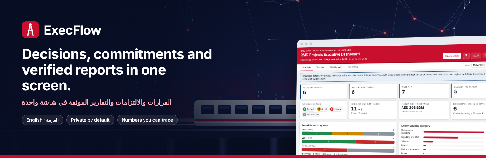
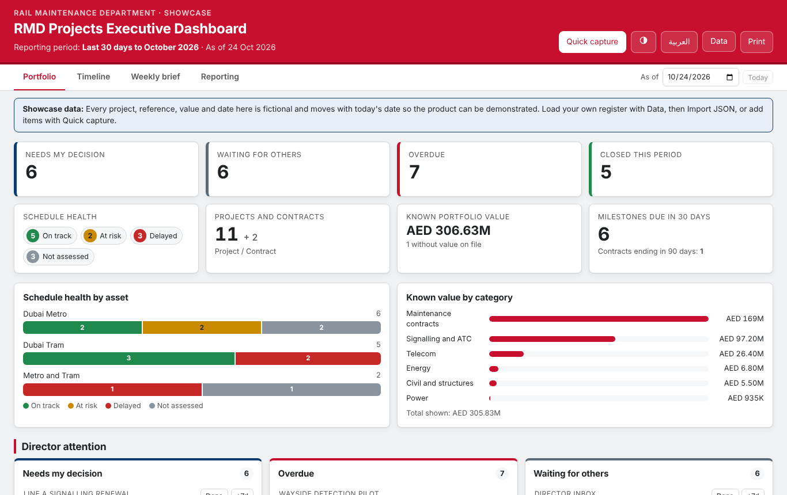
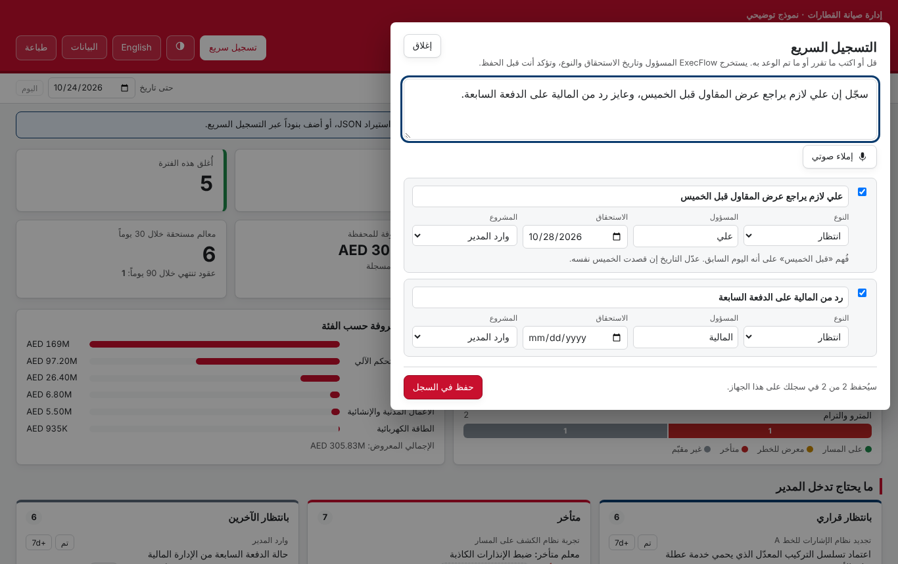
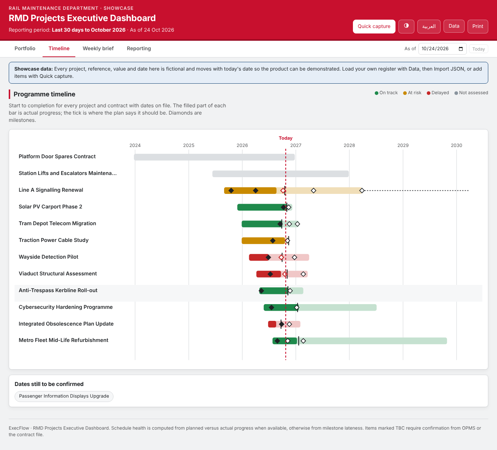
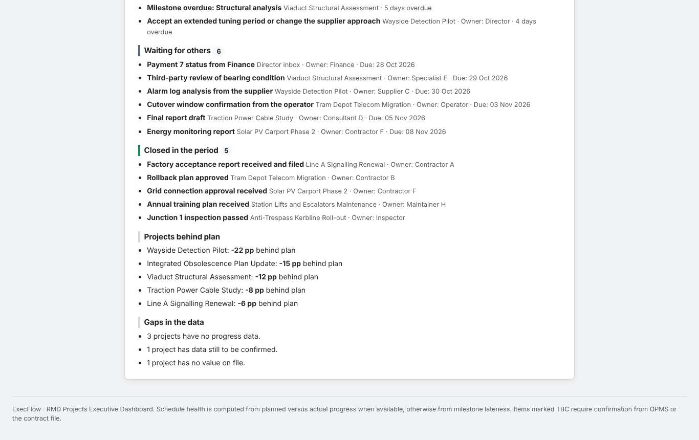
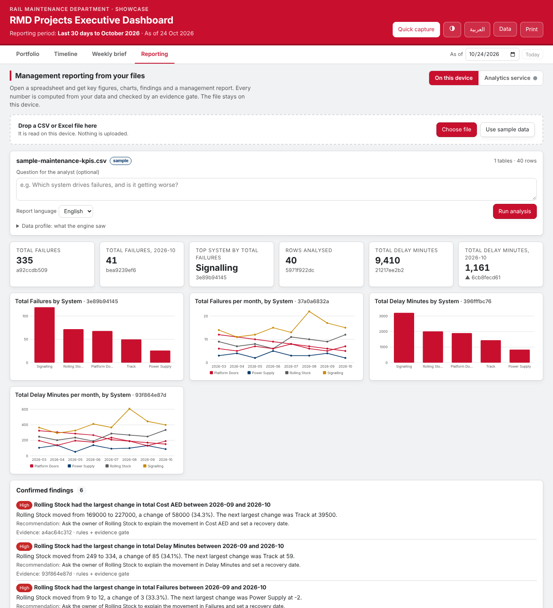
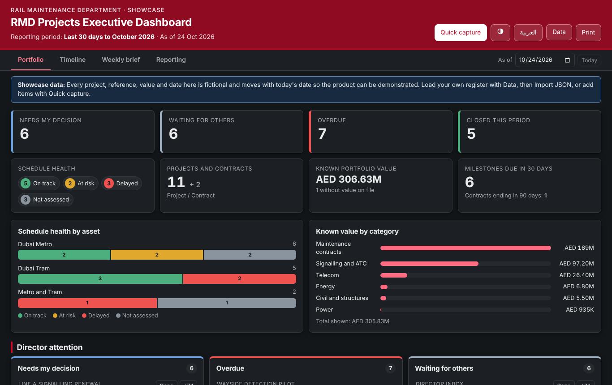
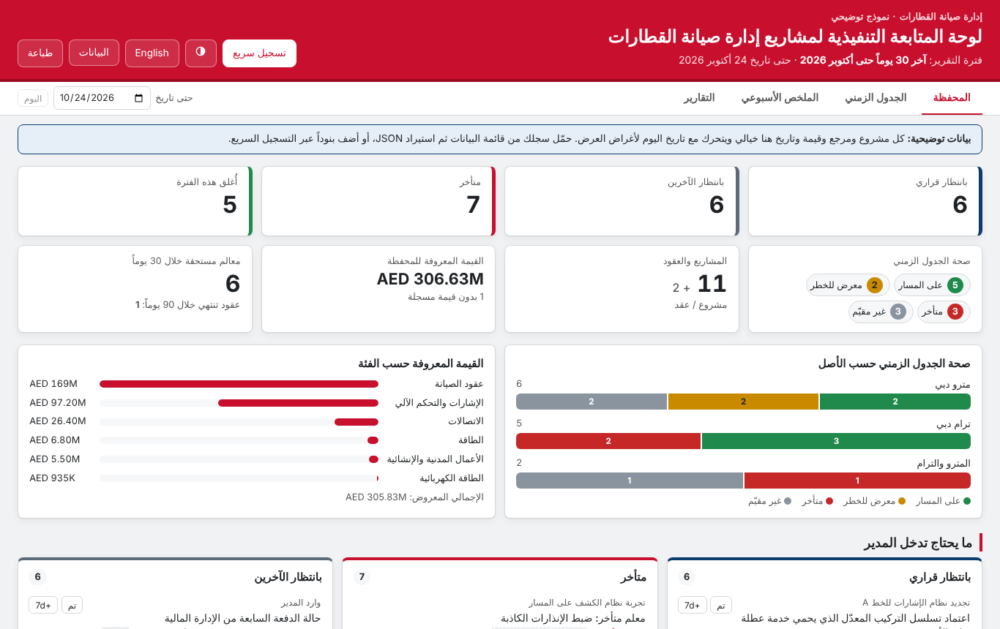
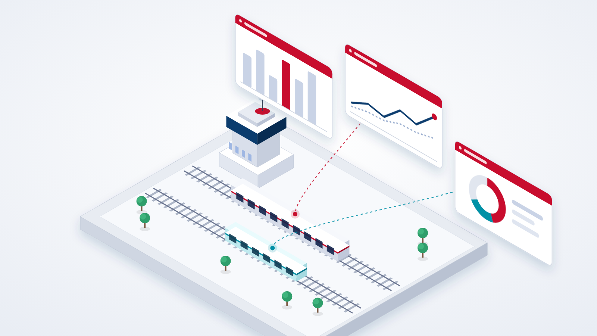
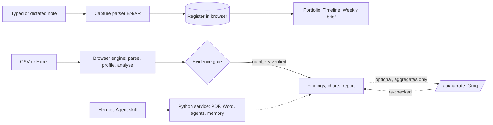

<p align="center">
  
</p>

<p align="center">
  <a href="https://github.com/ahmadzayan-hub/exeflow/actions/workflows/ci.yml"></a>
  
  
  
  
  
  
</p>

<p align="center">
  <b><a href="docs/user-guide.md">User guide</a></b> ·
  <b><a href="docs/deployment.md">Deploy</a></b> ·
  <b><a href="docs/architecture.md">Architecture</a></b> ·
  <b><a href="docs/data-governance.md">Data governance</a></b> ·
  <b><a href="README.ar.md">العربية</a></b>
</p>

# ExecFlow

> ماذا قررنا؟ من المسؤول؟ متى يجب أن ينتهي؟ ماذا تأخر؟ وما الذي يحتاج تدخل المدير الآن؟

ExecFlow is a decision and commitment register for railway executives, with a weekly director brief and management reports you can trace back to the data. It was built for a rail maintenance department that runs Dubai Metro and Dubai Tram projects and contracts, and it works in English and Arabic from the first screen.

It does three jobs and keeps them honest:

1. **Capture** what was decided or promised, by typing or dictating, in either language.
2. **Close the loop** with owners, due dates, overdue flags, contract expiries and a one-page weekly brief.
3. **Report** from a spreadsheet with figures that are computed, never invented, and checked before they reach the page.

The public demo runs on fictional data that moves with today's date. Your real register stays on your device.

## What you get

| | |
|---|---|
| **Portfolio.** Four director questions as tiles, schedule health by asset, value by category, and the attention list with *Done* and *+7d* on every row. |  |
| **Quick capture.** Say it in Arabic or English. Owner, due date and type are proposed; you confirm. |  |
| **Timeline.** Every project on one calendar: progress against plan, milestones, defects period, today line. |  |
| **Weekly brief.** What needs you, what slipped, who owes you what, what closed. Copy to WhatsApp, download Markdown, print to PDF. |  |
| **Reporting.** Drop a CSV or Excel file: key figures, charts, findings with evidence ids, and a management report in English or Arabic. The file never leaves the device. |  |

<p align="center">
  
  
</p>

Light, dark and system themes. Full right-to-left layout. Works at phone width and installs to the home screen.

## Why you can trust a number in it



Every figure comes from a deterministic function and carries an evidence id. A finding that quotes a number which is not in its evidence is rejected before it is shown. An AI model, when you choose to use one, may reword the verified text but cannot add facts: its answer is checked against the same numbers and discarded if anything is new.

Health is computed from planned against actual progress, or from late milestones when progress is missing. Nothing about a project's status is typed in by hand. When data is missing, the screen says *not assessed* and *to be confirmed* instead of guessing.

<br clear="right">

## Quick start

```bash
git clone https://github.com/ahmadzayan-hub/exeflow.git
cd exeflow
npm ci
npm run dev          # http://localhost:5173
```

```bash
npm test             # 166 tests: metrics, actions, capture parser, engine, serverless function
npm run build        # typecheck, production build, and release/rmd-dashboard.html (offline file)
```

Optional Python service for PDF and Word files and the multi-agent pipeline:

```bash
pip install -e "./server[dev]"
uvicorn execflow.api:app --port 8000 --app-dir server
```

## Deploy

Static hosting is enough. On Vercel the settings in [`vercel.json`](vercel.json) are picked up automatically; see [Deployment](docs/deployment.md) for the optional AI narrative, the access key, security headers and the private build. The build also produces a single self-contained HTML file for offline use.

## Privacy by design

| | |
|---|---|
| Real register | Never in the repository. `data/private/` is git-ignored; public builds stub it out at build time. |
| Files you analyse | Read in the browser. Nothing is uploaded in the default mode. |
| AI narrative | Optional. Only finding text and KPI values leave the device, through your own serverless function. |
| Accounts, cookies, analytics | None. |

Details and the exact data flows are in [Data governance](docs/data-governance.md).

## How it fits together



The code is organised so the logic is testable without a browser: [`src/metrics.ts`](src/metrics.ts), [`src/actions.ts`](src/actions.ts), [`src/capture.ts`](src/capture.ts), [`src/brief.ts`](src/brief.ts) and [`src/engine/`](src/engine/) are pure functions. See [Architecture](docs/architecture.md).

## Documentation

| | |
|---|---|
| [User guide](docs/user-guide.md) | Every screen, how health is decided, keyboard, where your data lives |
| [Architecture](docs/architecture.md) | Principles, data flow, source layout |
| [Data model](docs/data-model.md) | The register JSON, field by field |
| [Analytics](docs/analytics-os.md) | Browser engine, evidence gate, optional AI, Python agents, Hermes Agent |
| [Deployment](docs/deployment.md) | Vercel, offline file, private build, Docker |
| [Data governance](docs/data-governance.md) | What is public, what leaves the device, recovery |
| [Design system](docs/design-system.md) | Colour tokens, themes, right-to-left, accessibility |
| [Product charter](docs/charter.md) | The founding brief and start rule |
| [Roadmap](docs/roadmap.md) | What is next |
| [FAQ](docs/faq.md) | Short answers |

## Status and roadmap

Version 0.2.0. The weekly loop works end to end: capture, register, brief. Next are escalation rules, shared registers across a team, and `executive.action_overdue` events for the other products in the family. See the [roadmap](docs/roadmap.md).

## Contributing and security

Read [CONTRIBUTING](CONTRIBUTING.md) first. Security reports go through [SECURITY](SECURITY.md). Behaviour in discussions follows the [code of conduct](CODE_OF_CONDUCT.md).

## Licence

Copyright (c) 2026 Ahmed Zaian. All rights reserved. See [LICENSE](LICENSE). The fictional showcase data and example register may be used to try the product locally.
