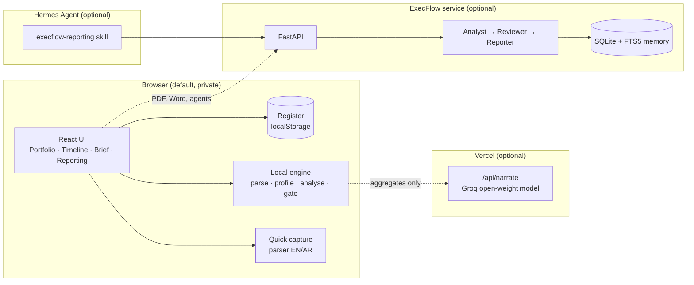

# Architecture

ExecFlow is a React application that does its core work in the browser, plus two optional server parts that add capability without being required.

## Principles

1. **Numbers come from code, words come from models.** Every figure shown in a finding, KPI or chart is computed by deterministic functions and carries an evidence id. A model may write prose around those facts. It never supplies them.
2. **Verify, do not trust.** An evidence gate checks every finding. A number in the text that is not in the cited evidence, and not a simple derivation of it, gets the finding rejected. The gate runs in the browser engine, in the Python service, and again on any AI-written report before it replaces the deterministic one.
3. **Private by default.** The default path reads files in the browser. Only aggregates ever leave the device, and only when you press the AI button and the deployment has a model key.
4. **The register is yours.** It is a single JSON document ([data model](data-model.md)). Export it, edit it, import it.
5. **Public builds contain no real data.** Public deployments ship a fictional showcase that moves with today's date. The real register is bundled only by an explicit private build.

## Source layout

| Path | Responsibility |
|---|---|
| `src/metrics.ts` | Health, flags, attention buckets, summaries. Pure functions, fully tested. |
| `src/actions.ts` | Every edit to the register as an immutable function. |
| `src/capture.ts` | Bilingual parser for Quick capture. |
| `src/brief.ts`, `src/timeline.ts` | The weekly brief and the timeline model. |
| `src/data/` | Showcase generator and the dataset selector. |
| `src/engine/` | Browser analytics engine: parse, profile, tools, gate, insights, report, narrate client. |
| `src/components/`, `src/views/` | UI. |
| `api/narrate.ts` | Vercel function for the optional AI narrative. |
| `server/execflow/` | Python service: ingestion for PDF and Word, agent pipeline, memory, API. |
| `hermes/` | Skill, configuration and dashboard plugin for Hermes Agent. |

## Why no backend is required

A director's first need is to see decisions and overdue items. That needs data and date arithmetic, not a server. Keeping this in the browser means the app deploys as static files, works offline as a single HTML file, and cannot leak what it never receives. Servers are added only where they earn their place: PDF and Word extraction, multi-step agent reasoning, and shared memory.
